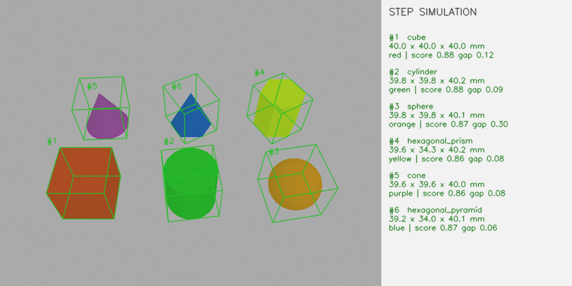

# D435 RGB-D 几何体识别与 STEP 仿真

使用 Python 融合 **RealSense D435 的 RGB、深度和可选第二路 USB RGB**，识别桌面上的简单几何体，输出形状、颜色、目标 ID 及外接长方体长宽高。通过几何模型拟合与多种观测加权评分完成判断，无需训练数据或 GPU。

没有相机也能运行：项目包含六类合成视频演示、六个 STEP 示例，以及可导入自定义 STEP 的中文虚拟工位。



*上图来自 STEP 网格仿真，不是 D435 实拍；识别器只使用渲染的图像与深度。*

## 功能与支持范围

| 功能 | 说明 |
| --- | --- |
| 默认六类 | 正方体、长方体、三棱锥、三棱柱、圆锥、圆柱 |
| 可选扩展至十二类 | 球体、正四/五/六棱锥、正五/六棱柱；提供独立仿真预设 |
| 尺寸与颜色 | 毫米制 `[L, W, H]`、外接正方体边长、颜色及一致性评分 |
| RGB-D 融合 | 支撑平面分割、点云表面拟合、可见深度一致性、RGB 轮廓评分 |
| 可选第二视角 | 标定后的 USB RGB 补充轮廓与颜色；仿真可启用第二路虚拟 RGB |
| 连续视频 | 分析线程处理最新帧，目标关联、跨帧确认与尺寸平滑 |
| 中文调参 | 滑块、数值输入、三套速度预设、ROI、配置保存与热重载 |
| 记录与回放 | JSONL 结果、RealSense `.bag` 录制/回放、性能统计 |
| STEP 调试 | 导入模型、调整摆放/颜色/视角、自动取景、模拟深度噪声与空洞 |

适用场景：多个**分开放置、不接触、不透明、基本单色**的物体，固定平整桌面，尺寸约 3–30 cm，D435 斜俯视。薄壁、镂空、组合体、堆叠和严重遮挡尚未完整支持。

## 1. 安装环境

当前验证平台为 **Windows x64、Python 3.13.3**，需要 Python 自带的 Tk。建议安装 Python 3.13 的 64 位版本，然后在 PowerShell 执行：

```powershell
git clone https://github.com/petershe1by/d435-rgbd-geometry.git
Set-Location d435-rgbd-geometry

# 基础识别环境
powershell -NoProfile -ExecutionPolicy Bypass -File .\install_environment.ps1

# 若需要 STEP 导入与仿真，使用这一条安装基础和仿真依赖
powershell -NoProfile -ExecutionPolicy Bypass -File .\install_environment.ps1 -Simulation
```

安装脚本创建独立的 `.venv`，固定依赖版本，执行依赖一致性检查和 GUI 自检。执行策略仅对该 PowerShell 进程生效。仓库不包含虚拟环境，换电脑后需要重新安装。

也可以手动安装：

```powershell
python -m venv .venv
.\.venv\Scripts\python.exe -m pip install --only-binary=:all: -r requirements-lock.txt
# 可选 STEP 依赖
.\.venv\Scripts\python.exe -m pip install --only-binary=:all: --constraint requirements-lock.txt -r requirements-simulation.txt
.\.venv\Scripts\python.exe -m pip check
```

核心依赖：NumPy 2.1.2、SciPy 1.16.0、OpenCV 4.11.0.86、pyrealsense2 2.58.4.10922。STEP 导入使用 Open CASCADE 的 no-VTK Python 包。详细说明见 [ENVIRONMENT.md](ENVIRONMENT.md)。

## 2. 先运行无相机演示

```powershell
# 六类合成 RGB-D 视频，带中文调参面板
.\.venv\Scripts\python.exe app.py --demo

# 无界面检查：逐帧分析并记录结果
.\.venv\Scripts\python.exe app.py --demo --headless --every-frame --frames 4 --output demo_results.jsonl
.\.venv\Scripts\python.exe evaluate_run.py demo_results.jsonl
```

前几次观测用于类别确认。默认至少需要 3 次有效一致观测；不确定时输出 `unknown`，不会强制给出尺寸。

## 3. 导入 STEP 进行虚拟识别

安装仿真依赖后启动：

```powershell
.\.venv\Scripts\python.exe step_simulator.py
```

新克隆的仓库默认加载 `models/examples/scene.json`，包含六类 STEP 示例。在面板中：

1. 点“新建场景”后“导入 STEP”，选择一个或多个文件。
2. 设置位置、绕 X/Y/Z 的角度、缩放和颜色；长度单位为 mm。
3. 按需启用“扩展 12 类仿真预设”和“第二路 RGB”。
4. 点“更新预览”和“自动取景”，然后“启动仿真识别”。启动时也会检查有效深度范围和画面边界。
5. 在识别窗口按 `q` 退出后再启动修改后的场景。

场景快照、参数快照和结果保存在自动创建的 `simulations/`。预览中的 CAD 参考尺寸与识别输出分开显示；识别器不读取 CAD 文件名、类别或参考尺寸作为答案。

```powershell
# 明确运行仓库自带场景，不依赖任何本机模型库
.\.venv\Scripts\python.exe app.py --scene models/examples/scene.json

# 可选十二类配置，主要针对约 40 mm 的模拟小物块调校
.\.venv\Scripts\python.exe step_simulator.py --scene models/examples/scene.json --config configs/simulation_extended.json

# 离线逐帧运行，输出到当前目录
.\.venv\Scripts\python.exe app.py --scene models/examples/scene.json --headless --every-frame --frames 8 --output step_results.jsonl
```

`configs/simulation_extended.json` 的噪声尺度和权重来自仿真调参，使用较大示例或实物时需要重新验证。启用十二类会增加相近类别间的歧义和计算量。

批量建立自己的物块库：

```powershell
.\.venv\Scripts\python.exe prepare_step_library.py 'D:\MyModels'
```

本机生成的 `models/user_blocks/` 含绝对路径，不上传到仓库；原始用户模型也不随仓库分发。在新电脑重新导入即可。详见 [STEP_SIMULATION.md](STEP_SIMULATION.md) 和 [USER_BLOCKS.md](USER_BLOCKS.md)。

## 4. 接入 D435

建议通过支持数据传输的 USB 3.x 线直连笔记本，先用 RealSense Viewer 确认 RGB 和深度均能出图，关闭 Viewer 后再运行：

```powershell
# 查询设备、可用视频模式并实际读取 5 帧
.\.venv\Scripts\python.exe check_environment.py --profiles --capture

# 清空桌面，固定相机，保存工位平面和背景
.\.venv\Scripts\python.exe app.py --calibrate-plane --workspace d435_workspace.npz

# 放入物体，使用相同工位标定启动识别
.\.venv\Scripts\python.exe app.py --workspace d435_workspace.npz --preset balanced --output live_results.jsonl
```

默认 RGB 和深度均为 **640×480、15 fps**。采集分辨率和帧率须同时被两路流支持；修改后重启并重新标定。相机、桌面位置或照明明显改变后也应重新标定。相机到物体表面的深度必须处于配置允许范围内，仅检查到桌面的距离不够。

- `Couldn't resolve requests`：所请求的视频模式无法解析，检查分辨率、帧率和 USB 类型。
- `Frame didn't arrive`：设备启动后没有收到帧，检查占用、数据线、端口、权限及驱动。
- `devices: 1`：只表示可以枚举设备，不代表 RGB-D 视频传输正常。

详细步骤见 [D435_VALIDATION.md](D435_VALIDATION.md)；一次实际连接排查记录见 [D435_CONNECTION_DIAGNOSIS.md](D435_CONNECTION_DIAGNOSIS.md)。

### 可选 USB 第二视角

固定两台相机，使工作区域重叠；准备 9×6 **内角点**、格子边长 25 mm 的棋盘格，按实际打印尺寸调整参数：

```powershell
.\.venv\Scripts\python.exe calibrate_stereo.py --usb 1 --cols 9 --rows 6 --square-mm 25
.\.venv\Scripts\python.exe app.py --usb 1 --stereo stereo_calibration.json
```

采集棋盘格时保持静止并覆盖不同位置和倾角，默认 25 对图像。启动识别后清空桌面按 `b` 保存两路背景。关联不明确、标定质量差或两路时差过大时，会降级为单视角评分。普通 USB 与 D435 没有硬件同步；主机接收时间门控不能代替曝光同步。

## 5. 调参和视频记录

默认打开中文调参面板；参数分为分割与深度、速度与模型、评分与稳定、颜色与区域四页。应用参数后重新确认类别和尺寸，保存按钮写入当前 `--config` 文件。输入错误不会覆盖有效配置。

| 按键 / 参数 | 作用 |
| --- | --- |
| `b` | 真实相机空桌面标定；虚拟场景不写真实标定 |
| `r` | 框选 ROI，Enter 确认 |
| `1` / `2` / `3` | 快速 / 均衡 / 精细预设 |
| `s` / `l` / `t` | 保存配置 / 重载配置 / 显示调参面板 |
| `q` / Esc | 退出 |
| `--no-tuning` / `--quiet` | 不打开调参面板 / 减少控制台输出 |
| `--headless` / `--watch-config` | 无界面 / 监视配置修改 |

建议先限定 ROI、标定空桌面，再调最小离桌高度和面积，确保一个物体对应一个轮廓；随后调整噪声尺度和颜色阈值，最后比较速度预设。不要仅为了消除 `unknown` 而持续降低分数或深度质量门限。

关键配置在 `config.json`，由 `rgbd_geometry/configuration.py` 校验：

| 参数 | 含义 |
| --- | --- |
| `min_object_height_m` / `min_component_pixels` | 分割阈值和最小面积 |
| `surface_noise_m` | 拟合的表面噪声尺度 |
| `weights` | 表面、深度、主 RGB、第二路 RGB 的权重 |
| `min_confidence` / `min_score_margin` | 确认分数及领先分差 |
| `min_depth_quality` / `min_stable_frames` | 深度有效占比与确认次数 |
| `extra_shapes` | 可选的六种扩展类别 |
| `surface_score_sigma` / `depth_score_sigma` | 表面/深度评分尺度倍率 |
| `score_smoothing_window` / `smoothing_window` | 类别评分 / 尺寸平滑窗口 |
| `fit_sample_points` / `refine_top_k` / `full_search_interval` | 拟合采样、精拟合候选数和全面搜索间隔 |
| `cube_relative_tolerance` / `cube_absolute_tolerance_m` | 正方体的近似等边容差 |
| `color` / `roi` | HSV 颜色阈值及工作区域 |

```powershell
# 录制原始 RGB-D；需要该工位对应的标定
.\.venv\Scripts\python.exe app.py --record scene.bag

# 回放逐帧分析，不接受同时融合实时 USB 图像
.\.venv\Scripts\python.exe app.py --bag scene.bag --headless --output replay_results.jsonl

# 本机合成性能基准
.\.venv\Scripts\python.exe benchmark.py --preset balanced --frames 20
```

## 输出和尺寸定义

每个已分析帧写一行 JSON。`--output` 指定文件，**每次启动会覆盖该文件**；自定义输出目录需要事先建立。主要字段示例：

```json
{
  "frame_number": 123,
  "processing_s": 0.42,
  "result_age_s": 0.44,
  "objects": [{
    "id": 1,
    "shape": "cylinder",
    "shape_zh": "圆柱",
    "candidate_shape": "cylinder",
    "confidence": 0.92,
    "score_margin": 0.13,
    "dimensions_mm": [80.0, 80.0, 120.0],
    "enclosing_cube_side_mm": 120.0,
    "color": {"name": "red", "name_zh": "红色", "confidence": 0.88},
    "dimension_source": "shape_model_fitted_to_rgbd",
    "quality_flags": ["single_view_hidden_dimensions_inferred"]
  }]
}
```

这是字段示例，不是实测结果。完整输出还含候选尺寸、各类别得分、质量标记和模型角点。未确认时 `shape` 为 `unknown`，`dimensions_mm` 为 `null`；`decision_reason` 给出确认中、类别歧义、深度不足等原因。

外接长方体与**桌面法向对齐**，底面为最小面积旋转矩形；输出 `[L, W, H]`，单位 mm，`L ≥ W`，H 是离桌高度。`enclosing_cube_side_mm = max(L, W, H)`。它不是任意三维姿态下的全局最小体积包围盒。背面等不可见尺寸包含模型假设推断；评分也不是经过统计校准的概率。

## 算法与代码入口

```text
D435 RGB + 深度 / 虚拟 RGB-D
    → 对齐与深度有效性检查
    → 桌面坐标系、连通域和 RGB 背景补边
    → 多类三维模型鲁棒拟合
    → 表面 + 可见深度 + 主 RGB + 可选第二路 RGB 加权评分
    → 目标关联、跨帧确认、颜色和尺寸输出
```

拟合使用多起点鲁棒最小二乘、可见射线约束和轮廓证据。连续帧复用上轮参数，周期全面搜索保留可靠旧解作为额外起点。立方体与长方体通过等边容差辅助区分；质量不足或候选接近时保留 `unknown`。默认权重为表面 0.30、深度 0.25、主 RGB 0.25、第二路 RGB 0.20；缺少第二视角时重新归一化。

| 文件 | 作用 |
| --- | --- |
| [rgbd_geometry/vision.py](rgbd_geometry/vision.py) | **核心识别**：`segment()`、`ModelFitter.fit()`、`color_estimate()`、`Tracker.update()` |
| [rgbd_geometry/geometry.py](rgbd_geometry/geometry.py) | 三维模型、桌面坐标、射线求交、外接尺寸 |
| [app.py](app.py) | `analyze()` 融合流程、视频循环、显示和 JSONL |
| [rgbd_geometry/cameras.py](rgbd_geometry/cameras.py) | D435/USB 采集、畸变校正、第二视角关联 |
| [rgbd_geometry/configuration.py](rgbd_geometry/configuration.py) | 配置校验、预设、热重载 |
| [rgbd_geometry/tuning.py](rgbd_geometry/tuning.py) | 中文调参面板 |
| [step_simulator.py](step_simulator.py) | STEP 场景编辑与仿真启动 |
| [rgbd_geometry/cad_simulation.py](rgbd_geometry/cad_simulation.py) | STEP 三角化、独立网格渲染、虚拟相机 |
| [calibrate_stereo.py](calibrate_stereo.py) | 双相机标定 |
| [check_environment.py](check_environment.py) | 环境、设备模式及实际收帧检查 |
| [evaluate_run.py](evaluate_run.py) / [benchmark.py](benchmark.py) | 运行统计 / 合成基准 |
| [models/examples/](models/examples/) | 六类 STEP 示例与相对路径场景 |
| [tests/](tests/) | 回归测试 |

## 测试与验证边界

```powershell
.\.venv\Scripts\python.exe -m unittest discover -s tests -v
```

当前套件含 **50 项测试**，覆盖基础识别、扩展模型、噪声/深度缺失、横放姿态、颜色、跟踪、配置与 GUI、模拟 SDK 资源释放、双相机投影、STEP 单位换算、遮挡及自动取景。完整运行需要安装仿真依赖和可用的桌面 GUI；部分 GUI / STEP 测试在条件不满足时会跳过。

2026-10-21 发布前，将待上传文件独立导出后运行验证：50 项测试全部通过，无跳过；合成演示与仓库 STEP 示例各运行 4 帧，末帧六个目标均正确确认。验证使用已有的项目 Python 环境，不等同于在全新电脑重新安装依赖。

本地还对一组用户 CAD 做过固定场景验证：A01–A12 单物体测试最终类别均正确；六物块 30 次观测中，前两次确认后 28/28 次均检出并正确分类。**这些模型参与过调参，视角与噪声固定，不是独立泛化准确率，也不是实机毫米级精度证明。**历史报告见 [RECOGNITION_FIX.md](RECOGNITION_FIX.md)；原始本机日志、外部 CAD 和标定文件不在仓库中。

识别线程不堆积待处理视频，始终取最新可用帧；采集帧率与识别帧率不同。`analysis_hz` 是尝试提交的上限，不能保证实际吞吐率。`result_age_s` 不包含真实曝光、USB 传输和显示的完整延迟。

真实 D435 采集、实物准确率及 USB 双相机标定仍需现场验收。建议使用独立尺寸、颜色、姿态的样品和卡尺真值，分别统计混淆矩阵、未知率、L/W/H 误差、ID 切换、处理帧率和延迟。

已知限制还包括：任意不等边/斜棱锥、偏心顶点、侧躺圆锥及任意翻滚姿态没有完整建模；透明、镜面、深黑材质或接触堆叠可能失败。STEP 仿真不包含重力碰撞、真实 D435 成像噪声、材质反光或真实双相机同步误差。

## 更多说明

- [运行环境](ENVIRONMENT.md)
- [STEP 仿真用法与场景格式](STEP_SIMULATION.md)
- [本机物块库导入与支持范围](USER_BLOCKS.md)
- [D435 实机验证步骤](D435_VALIDATION.md)
- [识别修复及历史仿真验证](RECOGNITION_FIX.md)
- [历史检查报告](VALIDATION_REPORT.md) / [准确度检查](ACCURACY_REVIEW.md)

虚拟环境、录制视频、本机模型索引、标定文件、分析日志和工作区内另一个独立视觉项目均由 `.gitignore` 排除。仓库仅分发本识别项目的源码、配置、测试、文档及生成的六类 STEP 示例。
